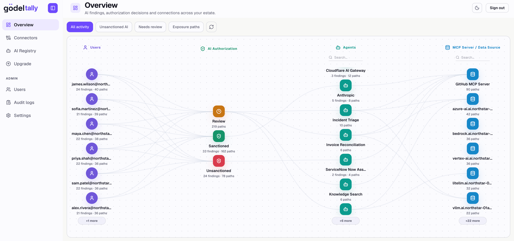
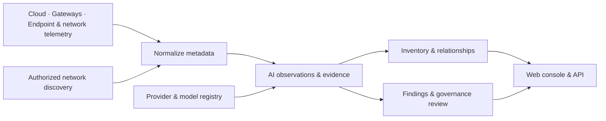

<div align="center">

# Gödel Tally

### Know which AI is in your organization. Know who is using it.

Open-source AI discovery, inventory, and governance — without storing prompts or responses.

[](LICENSE)
[](CHANGELOG.md)
[](Cargo.toml)

[Try it](#try-tally) · [Connectors](#connect-the-sources-you-already-have) · [How it works](#how-it-works) · [Docs](https://godel-labs.ai/docs/tally) · [Contribute](CONTRIBUTING.md)

</div>

An engineer starts a local model server. A team deploys an AI workflow. Someone connects a new
assistant to company tools. Your approved vendor list sees none of it.

**Tally turns cloud, gateway, endpoint, and network metadata into an AI inventory you can investigate.**
Follow the relationships between people, devices, agents, MCP servers, providers, and models. See
what is sanctioned, what needs review, and which source supplied the evidence.



*The built-in evaluation workspace. Real product names and realistic enterprise activity, generated for evaluation. No vendor connections are required.*

## What can you answer?

| Question | What Tally gives you |
| --- | --- |
| **What AI do we have?** | An inventory of observed providers, models, agents, MCP servers, cloud resources, and self-hosted runtimes. |
| **Who is using it?** | Source-reported people, endpoints, destinations, workloads, and bounded client/framework hints, where available. |
| **What needs a decision?** | Sanctioned, Unsanctioned, and Authorization Queue views, with provider and model decisions. |
| **Why do we believe this?** | Evidence type, originating connectors, timestamps, attribution confidence, and linked metadata. |
| **What changed?** | Connector run history, retained AI activity, and an audit trail of administrative operations. |

An installed application, a configured agent, a network connection, and an inference request are
different evidence. Tally preserves that distinction. Coverage depends on the sources you connect
and the permissions they have; an inventory is not proof that every AI system has been found.

## Try Tally

Install the latest release on **Linux or macOS, amd64 or arm64**:

```bash
curl -fsSL \
  https://raw.githubusercontent.com/godellabs-ai/godel-tally/main/install.sh \
  -o install-tally.sh && \
  bash install-tally.sh --port 2357
```

The script downloads the matching binary from [GitHub Releases](https://github.com/godellabs-ai/godel-tally/releases/latest),
verifies its checksum, downloads private PostgreSQL and ClickHouse runtimes in parallel, and starts Tally
as a user service (`systemd --user` on Linux, a LaunchAgent on macOS). The web console is embedded in
the binary; Docker, Node.js, and nginx are not required.

Run as your normal user with Bash, curl, tar, and OpenSSL available. The default private
installation needs **macOS 15+** or **Linux with glibc 2.36+** (for example Debian 12 or
Ubuntu 24.04), on amd64 or arm64. It uses no Homebrew, apt/yum, Python, or sudo. Linux
needs a working systemd user session for automatic startup; `--no-service` supports
manual startup. See the [installation guide](https://godel-labs.ai/docs/tally/installation).

Fresh installations live under `~/.godel-tally`: `app/` holds Tally, `runtime/` holds
versioned database binaries, `config/` holds settings and credentials, and `data/`
holds persistent database data, logs, and certificates. Set `TALLY_HOME` before installing
to choose another root. Legacy installations keep their saved paths and settings.
OS service registration files and Linux journal entries use the operating system's standard locations.

```text
~/.godel-tally/
├── app/       # Tally binary, launcher, scripts, and uninstaller
├── config/    # Configuration, credentials, and ClickHouse settings
├── runtime/   # Downloaded PostgreSQL and ClickHouse binaries
└── data/      # Database data, logs, certificates, and upgrade state
```
Database downloads are pinned and verified against SHA-256 hashes shipped with Tally;
reinstalling reuses complete cached runtimes. Database version changes require a new
Tally release; the installer does not fetch an untested “latest” database version.

Choose another HTTPS port with `--port`, for example `bash install-tally.sh --port 9443`.
Reinstalling without this option keeps the saved port.

Open **https://localhost:2357** (or your selected port) and create the first administrator account. The local certificate is
self-signed. [Existing databases](https://godel-labs.ai/docs/tally/installation#existing-databases)
are supported too. To run everything in containers instead, see
[Run in containers](#run-in-containers). For native Rust/Next.js development with live reload, follow the
[development setup](https://godel-labs.ai/docs/tally/development).

### Run in containers

As an alternative to the binary installer, run Tally, PostgreSQL, and ClickHouse with Docker Compose.
The Tally image is published as `quay.io/godellabs-ai/godel-tally` for linux/amd64 and linux/arm64;
the application runs from a `scratch` image with a static binary and CA certificates. Every setting lives in `.env` beside the Compose file, so create it first:

```bash
mkdir -p ~/godel-tally && cd ~/godel-tally
curl -fsSLO https://raw.githubusercontent.com/godellabs-ai/godel-tally/main/docker-compose.yml
(umask 077 && cat > .env <<EOF
TALLY_URL=https://localhost:2357
TALLY_PUBLISH_BIND=127.0.0.1:2357
TALLY_SECRET_KEY=$(openssl rand -hex 32)
TALLY_POSTGRES_PASSWORD=$(openssl rand -hex 32)
TALLY_CLICKHOUSE_PASSWORD=$(openssl rand -hex 32)
EOF
)
docker compose up -d --wait
```

If Compose reports `unhealthy`, inspect both startup progress and the last probe errors:

```bash
docker compose logs --tail=100 tallyd
docker inspect "$(docker compose ps -aq tallyd)" --format '{{json .State.Health}}'
docker compose exec tallyd /usr/local/bin/tallyd healthcheck
```

The built-in probe connects to the internal listener without a proxy or public DNS lookup and verifies
the HTTPS certificate. The image has no shell or curl. Keep the `.env` and data volumes when retrying.

Tally creates a self-signed certificate on first start; put `tally.crt` and `tally.key` in the `tls`
folder beside the Compose file to use your own. On an Apple silicon Mac with macOS 26, the same `.env`
works with [Apple container](https://github.com/apple/container):

```bash
curl -fsSLO https://raw.githubusercontent.com/godellabs-ai/godel-tally/main/deploy/apple/tally-container.sh
bash tally-container.sh up
```

See the [container installation guide](https://godel-labs.ai/docs/tally/installation#containers) for
HTTPS, updates, and removal.

### Follow the setup progress

The installer shows seven numbered steps: check your computer, download Tally, verify the
download, prepare the application, prepare the databases, secure the browser connection, and
finish setup. Blue marks progress, green marks success, yellow marks notes, and red marks a
stopped installation. Each status also has a text label. Colors turn off when output is saved
to a file, or when you set `NO_COLOR=1`.

Wait for **Tally is ready!**, then open the browser address shown. With `--no-start` or
`--no-service`, setup instead gives you a command to start Tally; it has not checked that the
browser console is ready. Private databases are prepared but stay stopped. Docker and
Apple-container provisioning may still start containers.

If setup stops, read **Where**, **What happened**, and **What to do next** at the end of the
output. Correct the reported problem and rerun the same command. Keep the saved settings file
and data directory; reinstalling reuses them.

**No connectors ready yet?** Click **Add evaluation data** on an empty Overview. Follow GPT-4o, Claude Sonnet 4,
Gemini 2.5 Pro, Llama 3.3, and other real models through a realistic enterprise workspace spanning
all connector types, all four connector categories, and all twelve normalized event types — including managed agents, cloud and Kubernetes resources, network evidence, model
usage, scanner history, and governance decisions.

**Settings → Evaluation workspace** lets an administrator add, restore, or remove these examples even
when real data is present. Removal previews the affected records and requires confirmation. Evaluation
records have their own identities; no credentials, scheduled polling, or actual scans are created.

Then connect one real source, sync it, and follow a finding back to its evidence.

### Start, stop, and restart

After installation, Tally runs as your user. On **Linux**:

```bash
systemctl --user start tally-server
systemctl --user stop tally-server
systemctl --user restart tally-server
systemctl --user status tally-server
```

On **macOS**:

```bash
# Stop
launchctl bootout "gui/$(id -u)/ai.godel.tally.server"
# Start again after stopping
launchctl bootstrap "gui/$(id -u)" "$HOME/Library/LaunchAgents/ai.godel.tally.server.plist"
# Restart: run the Stop command, then the Start command above
```

These commands start and stop **Tally and its private databases together**. Tally waits
for authenticated database readiness before starting its application. If a private database
exits or fails repeated health checks, the supervisor stops the application and remaining
database; the user service manager restarts the stack. A manual stop keeps it stopped.
Container and existing database lifecycles stay separate.

Private PostgreSQL uses local port `5433` and ClickHouse uses `8124` by default.
If another service already uses either port, Tally reports the database and port
and refuses startup before starting either database. It leaves that service alone
and does not automatically select another port.

With `--no-service`, run `bash ~/.godel-tally/app/tally.sh` and stop with Ctrl+C.
Private database logs are `~/.godel-tally/data/postgres.log` and `clickhouse.log`.
See [service management](https://godel-labs.ai/docs/tally/operations) for details.

### Uninstall

```bash
curl -fsSL \
  https://raw.githubusercontent.com/godellabs-ai/godel-tally/main/uninstall.sh \
  -o uninstall-tally.sh && \
  bash uninstall-tally.sh
```

The uninstaller removes Tally's application files and user services, and stops its private database
services and owned database containers. It **keeps configuration, credentials, database data, container
volumes, downloaded database runtimes, and legacy PostgreSQL/ClickHouse packages** so you can reinstall without losing data. Existing database
servers are untouched. Run `bash uninstall-tally.sh --dry-run` to preview, or set `TALLY_CONFIG_DIR` for
a custom installation. New installations also include `~/.godel-tally/app/uninstall.sh`.

To also remove managed PostgreSQL and ClickHouse **and permanently delete their data**:

```bash
bash uninstall-tally.sh --remove-databases --dry-run
bash uninstall-tally.sh --remove-databases
```

This removes private database data and downloaded runtimes, owned containers, and legacy packages/volumes recorded as created by
the installer. Pre-existing packages, existing database servers, and unrecorded volumes are kept.
Older installs without ownership records retain their packages. Configuration, certificates, logs,
and backups outside the database directories remain. Back up before using this option; Linux package
removal for legacy package-based installations may use sudo. Private downloads never need sudo. See [uninstall details](https://godel-labs.ai/docs/tally/operations#remove-databases).

## Connect the sources you already have

| Category | Sources |
| --- | --- |
| **AI agents & platforms** | ServiceNow AI Agents, n8n, Microsoft Copilot Studio, LangSmith / LangGraph, Dify; Amazon Bedrock / SageMaker, Azure OpenAI / AI Foundry, Google Vertex AI |
| **AI gateways & proxies** | LiteLLM, Cloudflare AI Gateway |
| **Internet access & security** | Microsoft Defender streaming and API sources, CrowdStrike, Zscaler, Palo Alto, NextDNS, Cato Networks, Cloudflare Gateway / Zero Trust and CASB |
| **Infrastructure discovery** | AWS, Azure, and GCP network flows and resource mappings; Kubernetes; Tally's explicitly authorized network scanner |

Different sources expose different evidence. A managed-agent inventory shows configuration; DNS
and flow logs show network activity; supported request signatures can identify AI usage. Network
telemetry alone cannot identify a local agent or a stdio MCP server. Client hints are not proof of
a particular running agent.

The [connector catalog](apps/web/lib/connector-catalog.ts), [sanitized fixtures](testdata/connectors),
and [user guide](https://godel-labs.ai/docs/tally/inventory-and-findings) describe the implementations. Evaluation coverage demonstrates the
data model; it does not certify a live integration with each vendor.

## Metadata, with a purpose

Tally normalizes supported source metadata and discards raw source payloads, prompts, responses,
documents, and unrelated non-AI logs. Retained attribution can include hostnames, IP addresses,
user emails or source IDs, workload names, and bounded client identifiers. **Metadata is still
sensitive data**: deploy and grant access accordingly.

- AI logs expire after **90 days by default**; durable inventory survives log expiration.
- Connector credentials are encrypted at rest with the installation's `TALLY_SECRET_KEY`.
- Standalone access requires sign-in. The first account is an administrator; subsequent users need an invitation, which grants the Member or Administrator role. Tally always keeps at least one enabled administrator.
- Passwords are 12 to 1,024 characters (at most 4,096 UTF-8 bytes) and may not be whitespace-only, common, use fewer than four distinct characters, or contain the account's email address. Sessions last 12 hours from sign-in. Invitations last 7 days and reset links one hour.
- Credential endpoints share a per-IP token bucket: a burst of 20 requests, replenished at 20 requests per minute. Five failures for one email pause that address/email pair; 30 failures across emails pause the address. Failure windows last 15 minutes from the first failure. An account locks for 15 minutes after 50 consecutive failures across addresses; attempts during that lock do not extend it or revoke existing sessions.
- Limits use the connection's peer IP, not forwarded headers. Users behind a reverse proxy or shared NAT share its budget and address-wide pause; the Next.js development proxy also shares one address. Direct HTTPS access preserves distinct addresses where the network permits. In-memory IP limits reset on restart; account locks persist in PostgreSQL.
- Throttling retains at most 50,000 address and address/email entries. At capacity, new addresses receive HTTP 429 until space is reclaimed. If a failed sign-in cannot allocate an email entry, that address is paused for 15 minutes. Existing pauses are preserved; expired entries are reclaimed at most once per minute.
- The audit log records the signed-in user for account changes, sign-ins, connector, registry, scan and data operations, including deletion of the audit log itself.
- Administrators can preview and delete selected data categories or all operational data. Accounts, installation identity, and the built-in catalog are preserved.

Read the [privacy and storage model](https://godel-labs.ai/docs/tally/privacy-and-data) and [security policy](SECURITY.md).

## How it works



The primary production package is **one Rust executable, `tallyd`**, with its web console embedded.
It runs the API, authentication, connector worker, registry, and upgrade runtime. PostgreSQL stores
control and governance data; ClickHouse stores AI telemetry and inventory. Production does not need
Node.js or nginx.

```bash
make build       # Build tallyd with the production UI embedded
make run         # Run locally; Docker databases by default
```

Release binaries are available for Linux and macOS on amd64 and arm64. The installer supports private downloaded (`native`),
Docker, Apple-container, or existing databases, independently for PostgreSQL and ClickHouse. The same
executable is published as the `quay.io/godellabs-ai/godel-tally` image for the
[container deployment](#run-in-containers); `make push-image` publishes it for linux/amd64 and linux/arm64.
See [installation and operations](https://godel-labs.ai/docs/tally/installation) for deployment details.

### Tally and Gödel Gate

Tally is the inventory and governance product. A sanction decision records organizational approval;
it does not, by itself, block a request at a provider, gateway, or endpoint.

Gödel Gate adds enforcement capabilities and embeds Tally's discovery components. The Tally
deletion screen uses the same target → preview → confirmation flow in both products. The
[upgrade guide](https://godel-labs.ai/docs/tally/upgrade-to-gate) explains the cutover and migration boundaries. Gate requires Docker.

## Status and contributing

**Alpha.** APIs, schemas, and operational behavior may change before 1.0. Live vendor behavior and
coverage need validation in your environment. We welcome reproducible connector gaps, sanitized
fixtures, privacy improvements, and feedback on the review workflow.

```bash
make check       # Build UI, format-check, lint, test, and verify generated contracts
```

Check occupied PostgreSQL and ClickHouse ports against a built binary without starting databases:

```bash
python3 scripts/test-supervisor-ports.py --binary /path/to/tallyd
```

Start with [CONTRIBUTING.md](CONTRIBUTING.md). To propose connector support, include the source,
the metadata it exposes, and a sanitized example. Please keep credentials and customer data out of
issues. Report security vulnerabilities through [SECURITY.md](SECURITY.md).

| Explore | Link |
| --- | --- |
| Operate Tally | [User guide](https://godel-labs.ai/docs/tally/inventory-and-findings) · [Installation](https://godel-labs.ai/docs/tally/installation) · [FAQ](FAQ.md) |
| Understand the internals | [Architecture](https://godel-labs.ai/docs/tally/architecture) · [AI estate](https://godel-labs.ai/docs/tally/inventory-and-findings) · [Data model](https://godel-labs.ai/docs/tally/privacy-and-data) |
| Build integrations | [OpenAPI](specs/openapi.json) · [JSON schemas](specs) · [Connector fixtures](testdata/connectors) |
| Follow changes | [Changelog](CHANGELOG.md) |

Licensed under [Apache 2.0](LICENSE).
