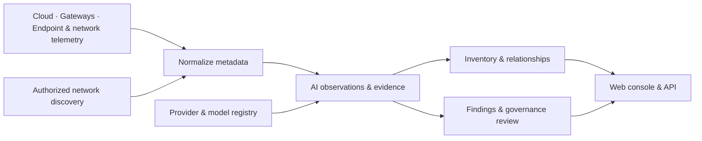

<div align="center">

# Gödel Tally

### Know which AI is in your organization. Know who is using it.

Open-source AI discovery, inventory, and governance — without storing prompts or responses.

[](LICENSE)
[](CHANGELOG.md)
[](Cargo.toml)

[Try it](#try-tally) · [Connectors](#connect-the-sources-you-already-have) · [How it works](#how-it-works) · [Docs](docs/user-guide.md) · [Contribute](CONTRIBUTING.md)

</div>

An engineer starts a local model server. A team deploys an AI workflow. Someone connects a new
assistant to company tools. Your approved vendor list sees none of it.

**Tally turns cloud, gateway, endpoint, and network metadata into an AI inventory you can investigate.**
Follow the relationships between people, devices, agents, MCP servers, providers, and models. See
what is sanctioned, what needs review, and which source supplied the evidence.


*The built-in evaluation workspace. Real product names and realistic enterprise activity, generated for evaluation. No vendor connections are required.*

## What can you answer?

| Question | What Tally gives you |
| --- | --- |
| **What AI do we have?** | An inventory of observed providers, models, agents, MCP servers, cloud resources, and self-hosted runtimes. |
| **Who is using it?** | Source-reported people, endpoints, destinations, workloads, and bounded client/framework hints, where available. |
| **What needs a decision?** | Sanctioned, Unsanctioned, and Authorization Queue views, with provider and model decisions. |
| **Why do we believe this?** | Evidence type, originating connectors, timestamps, attribution confidence, and linked metadata. |
| **What changed?** | Connector run history, retained AI activity, and an audit trail of administrative operations. |

An installed application, a configured agent, a network connection, and an inference request are
different evidence. Tally preserves that distinction. Coverage depends on the sources you connect
and the permissions they have; an inventory is not proof that every AI system has been found.

## Try Tally

Install the latest release on **Linux or macOS, amd64 or arm64**:

```bash
curl -fsSL https://raw.githubusercontent.com/godellabs-ai/godel-tally/main/install.sh -o install-tally.sh && bash install-tally.sh
```

The script downloads the matching binary from [GitHub Releases](https://github.com/godellabs-ai/godel-tally/releases/latest),
verifies its checksum, installs PostgreSQL and ClickHouse, creates Tally's databases, and starts Tally
as a user service (`systemd --user` on Linux, a LaunchAgent on macOS). The web console is embedded in
the binary; Docker, Node.js, and nginx are not required.

Run as your normal user with Bash, curl, tar, and OpenSSL available. macOS needs
[Homebrew](https://brew.sh); Linux needs sudo for native database packages and a working systemd user
session. See the [installation guide](docs/quickstart.md) for supported package managers and service details.

Open **https://localhost:8443** and create the first administrator account. The local certificate is
self-signed. To use Docker or Apple containers for the databases, run `bash install-tally.sh --db docker`
or `bash install-tally.sh --db apple`. [Existing databases](docs/quickstart.md#choose-database-deployment-independently)
are supported too. For native Rust/Next.js development with live reload, follow the
[development setup](docs/quickstart.md#development).

**No connectors ready yet?** Click **Add evaluation data** on an empty Overview. Follow GPT-4o, Claude Sonnet 4,
Gemini 2.5 Pro, Llama 3.3, and other real models through a realistic enterprise workspace spanning
all connector types, all four connector categories, and all twelve normalized event types — including managed agents, cloud and Kubernetes resources, network evidence, model
usage, scanner history, and governance decisions.

**Settings → Evaluation workspace** lets an administrator add, restore, or remove these examples even
when real data is present. Removal previews the affected records and requires confirmation. Evaluation
records have their own identities; no credentials, scheduled polling, or actual scans are created.

Then connect one real source, sync it, and follow a finding back to its evidence.

### Start, stop, and restart

After installation, Tally runs as your user. On **Linux**:

```bash
systemctl --user start tally-server
systemctl --user stop tally-server
systemctl --user restart tally-server
systemctl --user status tally-server
```

On **macOS**:

```bash
# Stop
launchctl bootout "gui/$(id -u)/ai.godel.tally.server"
# Start again after stopping
launchctl bootstrap "gui/$(id -u)" "$HOME/Library/LaunchAgents/ai.godel.tally.server.plist"
# Restart a loaded service
launchctl kickstart -k "gui/$(id -u)/ai.godel.tally.server"
```

These commands control Tally; the databases keep running. See [service management](docs/quickstart.md#services-and-upgrades)
for logs, startup at login, and database services.

### Uninstall

```bash
curl -fsSL https://raw.githubusercontent.com/godellabs-ai/godel-tally/main/uninstall.sh -o uninstall-tally.sh && bash uninstall-tally.sh
```

The uninstaller removes Tally's application files and user services, and stops its private database
services and owned database containers. It **keeps configuration, credentials, database data, container
volumes, and PostgreSQL/ClickHouse packages** so you can reinstall without losing data. Existing database
servers are untouched. Run `bash uninstall-tally.sh --dry-run` to preview, or set `TALLY_CONFIG_DIR` for
a custom installation. New installations also include `~/.local/lib/godel-tally/uninstall.sh`.

## Connect the sources you already have

| Category | Sources |
| --- | --- |
| **AI agents & platforms** | ServiceNow AI Agents, n8n, Microsoft Copilot Studio, LangSmith / LangGraph, Dify; Amazon Bedrock / SageMaker, Azure OpenAI / AI Foundry, Google Vertex AI |
| **AI gateways & proxies** | LiteLLM, Cloudflare AI Gateway |
| **Internet access & security** | Microsoft Defender streaming and API sources, CrowdStrike, Zscaler, Palo Alto, NextDNS, Cato Networks, Cloudflare Gateway / Zero Trust and CASB |
| **Infrastructure discovery** | AWS, Azure, and GCP network flows and resource mappings; Kubernetes; Tally's explicitly authorized network scanner |

Different sources expose different evidence. A managed-agent inventory shows configuration; DNS
and flow logs show network activity; supported request signatures can identify AI usage. Network
telemetry alone cannot identify a local agent or a stdio MCP server. Client hints are not proof of
a particular running agent.

The [connector catalog](apps/web/lib/connector-catalog.ts), [sanitized fixtures](testdata/connectors),
and [user guide](docs/user-guide.md) describe the implementations. Evaluation coverage demonstrates the
data model; it does not certify a live integration with each vendor.

## Metadata, with a purpose

Tally normalizes supported source metadata and discards raw source payloads, prompts, responses,
documents, and unrelated non-AI logs. Retained attribution can include hostnames, IP addresses,
user emails or source IDs, workload names, and bounded client identifiers. **Metadata is still
sensitive data**: deploy and grant access accordingly.

- AI logs expire after **90 days by default**; durable inventory survives log expiration.
- Connector credentials are encrypted at rest with the installation's `TALLY_SECRET_KEY`.
- Standalone access requires sign-in. The first account is an administrator; subsequent users need an invitation.
- Administrators can preview and delete selected data categories or all operational data. Accounts, installation identity, and the built-in catalog are preserved.

Read the [privacy and storage model](docs/data-model.md) and [security policy](SECURITY.md).

## How it works



The primary production package is **one Rust executable, `tallyd`**, with its web console embedded.
It runs the API, authentication, connector worker, registry, and upgrade runtime. PostgreSQL stores
control and governance data; ClickHouse stores AI telemetry and inventory. Production does not need
Node.js or nginx.

```bash
make build       # Build tallyd with the production UI embedded
make run         # Run locally; Docker databases by default
```

Release binaries are available for Linux and macOS on amd64 and arm64. The installer supports native,
Docker, Apple-container, or existing databases, independently for PostgreSQL and ClickHouse.
See [installation and operations](docs/quickstart.md) for deployment details.

### Tally and Gödel Gate

Tally is the inventory and governance product. A sanction decision records organizational approval;
it does not, by itself, block a request at a provider, gateway, or endpoint.

Gödel Gate adds enforcement capabilities and embeds Tally's discovery components. The Tally
deletion screen uses the same target → preview → confirmation flow in both products. The
[upgrade guide](docs/upgrade-to-gate.md) explains the cutover and migration boundaries. Gate requires Docker.

## Status and contributing

**Alpha.** APIs, schemas, and operational behavior may change before 1.0. Live vendor behavior and
coverage need validation in your environment. We welcome reproducible connector gaps, sanitized
fixtures, privacy improvements, and feedback on the review workflow.

```bash
make check       # Build UI, format-check, lint, test, and verify generated contracts
```

Start with [CONTRIBUTING.md](CONTRIBUTING.md). To propose connector support, include the source,
the metadata it exposes, and a sanitized example. Please keep credentials and customer data out of
issues. Report security vulnerabilities through [SECURITY.md](SECURITY.md).

| Explore | Link |
| --- | --- |
| Operate Tally | [User guide](docs/user-guide.md) · [Installation](docs/quickstart.md) · [FAQ](FAQ.md) |
| Understand the internals | [Architecture](docs/architecture.md) · [AI estate](docs/ai-estate.md) · [Data model](docs/data-model.md) |
| Build integrations | [OpenAPI](specs/openapi.json) · [JSON schemas](specs) · [Connector fixtures](testdata/connectors) |
| Follow changes | [Changelog](CHANGELOG.md) |

Licensed under [Apache 2.0](LICENSE).
